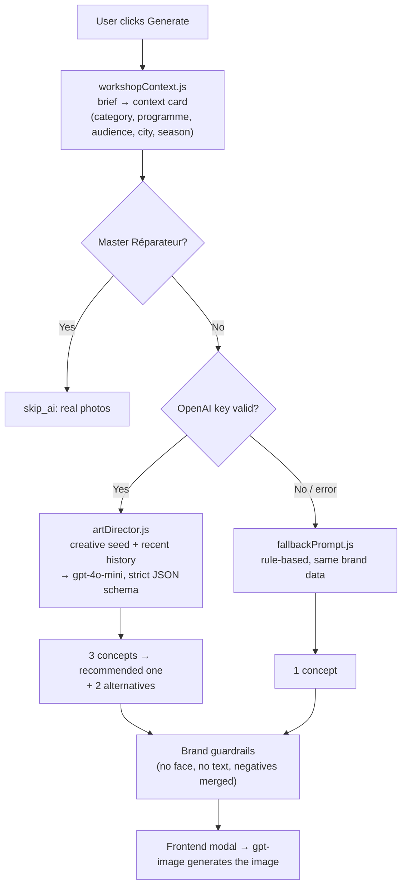

# 🎨 HK Studio — Prompting System Guide (Orange Maroc edition)

The prompting system now does three things the old one didn't:

1. **It reads the whole workshop context.** Programme, audience, city, season and level go to the LLM, not just the title.
2. **It proposes 3 concepts per brief**: one *faithful*, one *Artisanat × Numérique*, one *bold*. The best one goes in the existing fields and the other two come back as `alternatives`.
3. **It doesn't repeat itself.** A random creative seed, chosen in code, and a memory of the last 12 compositions push every generation somewhere new.

All Orange Maroc brand rules live in **one file**, `server/prompts/orangeMarocBrand.js`. The LLM layer and the fallback both read from it.



---

## 📁 Files

| File | Role | Edit it when… |
|---|---|---|
| `server/prompts/orangeMarocBrand.js` | Brand DNA: palette, orange touches, Moroccan touches, craft × digital metaphors, negatives, programmes, audience directions | You want to change the **look**: the most common edit |
| `server/prompts/artDirector.js` | Layer 1: LLM system prompt, user message, JSON schema, OpenAI call, anti-repetition memory | You want to change **how the LLM thinks** |
| `server/prompts/workshopContext.js` | Reads a brief, detects category, programme and audience | A new topic or programme isn't detected |
| `server/prompts/fallbackPrompt.js` | Layer 2: rule-based fallback | You want better results with no API key |
| `server/prompts/index.js` | Entry point `generateImagePrompt(brief)` | Rarely |
| `scripts/try-prompt.js` | CLI for testing a brief | — |
| `test/prompts.test.js` | Tests (OpenAI is mocked) | After any change, run `npm test` |

---

## 🔌 Wiring it into the existing app

In `server/routes/ai.js`, replace the block that builds `systemPromptContent`, calls GPT-4o-mini and falls back to `promptGenerator.js` with:

```js
const { generateImagePrompt } = require('../prompts');

// inside the route handler
const result = await generateImagePrompt({
  title: brief.title,
  description: brief.description,  // optional
  program: brief.program,          // optional: odc_club | ecole_du_code | fablab | orange_fab | super_codeurs | master_reparateur
  audience: brief.audience,        // optional: kids | students | young_adults | women | startups | makers | artisans | general
  city: brief.city,                // optional: Rabat, Casablanca, Agadir…
  date: brief.date,                // optional: used for the season
  level: brief.level,              // optional
});
res.json(result);
```

Adapt the field names to your brief object. Only `title` is required, and everything else is inferred when missing. The key comes from `OPENAI_API_KEY`, as before. Set `OPENAI_PROMPT_MODEL` to use a different model; the default is `gpt-4o-mini`.

### Response shape

Older frontends keep working because the fields they already read are unchanged:

```
workshop_category, visual_strategy, composition_type, human_presence_mode,
environment, main_subject, image_prompt, negative_prompt, design_notes_for_studio
```

New fields you can show in the modal:

| Field | Meaning |
|---|---|
| `concept_title` | Short name of the concept (FR) |
| `creative_angle` | `faithful`, `craft_digital` or `bold` |
| `context_reading` | One sentence on what the workshop brings to its audience (FR) |
| `orange_touch` / `moroccan_touch` / `lighting` | The ingredients, so the designer can see them at a glance |
| `alternatives` | The two other concepts, same shape. **Idea:** show them as 3 cards in the modal and let the user pick before generating the image |
| `source` | `llm`, `fallback` or `real_photos` |

> [!IMPORTANT]
> `human_presence_mode` still uses the 6 existing values, so `BriefsPage.vue` needs no change. `composition_type` has **new values** (`craft_digital`, `aftermath`, `macro_texture`, `unexpected_viewpoint`, and `hands_closeup` instead of "close-up mains"). If the frontend shows a label per composition type, add these labels there.

---

## 🟠 The brand rules (`orangeMarocBrand.js`)

| Rule | How it's enforced |
|---|---|
| **Simple, authentic, warm, optimistic photos** | `PHOTO_PRINCIPLES_FR`, injected into the system prompt |
| **One touch of orange**: one natural object, never a filter or a dominant colour | `ORANGE_TOUCHES` list; `orange filter`, `orange-dominant scene`… in negatives |
| **Modern Morocco, not a postcard**: at most one subtle cue (mashrabiya shadow, tadelakt, zellige band, cedar wood, Moroccan light) | `MOROCCAN_TOUCHES`; camels, dunes, souk stalls and orientalism in negatives |
| **Zero faces** | System prompt plus `NO_FACE_CLAUSE`, appended in code if the LLM forgets it |
| **Zero text or logos** | System prompt plus `NO_TEXT_CLAUSE`, appended in code |
| **No tech clichés** | Holograms, glowing brains, hooded hackers, matrix rain… in negatives |
| **Kids** | Low viewpoint, Orange supporting palette in small touches, small hands only. The fallback never uses back views for kids |
| **Inclusion** | Audience directions, including "no pink by default" for women-focused workshops |

> [!NOTE]
> These rules interpret the Orange photography principles for Morocco. Check them against the official Orange brand book and adjust the values in this one file.

### The creative signature: Artisanat × Numérique

`CRAFT_DIGITAL_METAPHORS` pairs a Moroccan craft with a digital skill:

| Craft | Digital topics | Visual idea |
|---|---|---|
| Zellige | design, web, mobile | tiles assembled like UI components / pixel grid |
| Tissage | coding, cloud, data | loom threads as code or network lines, one orange thread |
| Poterie | fablab, Orange Fab | clay on a wheel next to a 3D-printed piece |
| Ciselure du laiton | cybersecurity | chiselled brass lock as encryption layers |
| Marqueterie (thuya) | data, project management | inlaid pieces fitting together like a dashboard |
| Calligraphie | design, AI | reed pen and ink next to a stylus and tablet |
| Mosaïque | AI, data | tiles sorted by colour, like a model learning patterns |
| Maroquinerie | Orange Fab, mobile | leather notebook next to a phone prototype |
| Réparation | repair, fablab | repair tools neatly laid out, every screw in its place |

Each brief gets one of these at random (matched to its category) for its `craft_digital` concept. **Add your own here.** This is the quickest way to make the visuals more original.

---

## 🧠 Layer 1: how the LLM is steered (`artDirector.js`)

**System prompt** (`buildSystemPrompt`, in French): brand DNA, modern Morocco, Artisanat × Numérique, zero faces, zero text, fidelity to the subject, the 3 required concepts, and how to write `image_prompt` (80–140 words in English: framing → place → subject → human presence → orange touch → Moroccan touch → light → mood; 35/50 mm, shallow depth of field).

**User message** (`buildUserMessage`): the context card, plus:
- **Creative seed (random, picked in code):** the craft metaphor, a *fresh* composition for the bold concept (never one of the last 4 used), a suggested orange touch, Moroccan touch and light.
- **Recent history:** the last 12 `composition_type : main_subject` pairs, marked "à ne pas répéter".

**Strict JSON schema:** OpenAI structured outputs guarantee valid JSON with the expected enums, so the old JSON-parsing failures shouldn't happen any more.

**Temperature 0.9** for creativity. The schema and the code guardrails keep it on-brand.

### ✏️ Common edits

| I want… | Edit |
|---|---|
| A new composition type | Add it to `COMPOSITION_TYPES` in `artDirector.js` (with a comment) and to the frontend labels |
| More or fewer Moroccan cues | `MOROCCAN_TOUCHES` in `orangeMarocBrand.js`. To turn them off, remove the Moroccan section from the system prompt |
| A new programme | `PROGRAMS` in `orangeMarocBrand.js`, plus `CATEGORY_PROGRAM` in `workshopContext.js` if a category should map to it |
| A topic that's detected wrongly | Keywords in `CATEGORIES` (`workshopContext.js`). Keywords of 3 letters or fewer match whole words only |
| Fewer repeats | Increase `HISTORY_SIZE` in `artDirector.js` |
| A different model | `OPENAI_PROMPT_MODEL=gpt-4o` (env var) |

---

## 🔧 Layer 2: the fallback (`fallbackPrompt.js`)

The fallback runs when the key is missing or OpenAI fails. It returns the same shape with `source: 'fallback'` and no alternatives. Subjects come from `TOPIC_SUBJECTS` first (the tool named in the title: Arduino, Python, Power BI, Figma, Docker…), then from `SUBJECTS[category]`. It uses the same orange touches, Moroccan touches, light and negatives as the LLM layer.

> [!NOTE]
> `server/utils/promptGenerator.js` is no longer called once `ai.js` uses `generateImagePrompt`. Keep it until you've compared results, then delete it. If you'd rather keep it as the fallback, change `generateFallback` in `server/prompts/index.js` to call it instead.

---

## 🧪 Testing

```bash
npm test                                                     # 9 tests, OpenAI mocked
node scripts/try-prompt.js "Initiation à Arduino" --audience kids --city Agadir
OPENAI_API_KEY=sk-... node scripts/try-prompt.js "Pitch ta startup" --program orange_fab --debug
```

`--debug` prints the context card, the full system prompt and the user message sent to OpenAI.

> [!WARNING]
> After editing any file in `server/prompts/`, restart the server: kill it, then run `node server/index.js`.
