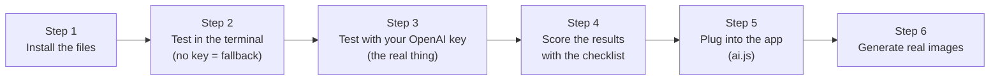

# 🧪 HK Studio — Test the New Orange Maroc Prompting

This guide lets you test the new prompting system yourself, step by step, first **without touching the app**, then **inside the app**.

The full source code is in the [Appendix](#-appendix--full-source-code), so this document is enough on its own: you don't need access to the GitHub repo.



---

## 📦 Step 1 — Install the files

Your project is in `/Users/mehdi/Desktop/HK`. The new files go **next to** your existing code; nothing is overwritten.

### Option A: from GitHub (fastest)

```bash
cd /Users/mehdi/Desktop
git clone -b claude/friendly-curie-a7ztxe https://github.com/contacthaddiouimehdi-cmd/errantew.git hk-prompts
cp -R hk-prompts/server/prompts HK/server/prompts
mkdir -p HK/scripts HK/test
cp hk-prompts/scripts/try-prompt.js HK/scripts/
cp hk-prompts/test/prompts.test.js HK/test/
```

### Option B: copy from this document

Create these files in your HK project and paste the code from the [Appendix](#-appendix--full-source-code):

| File to create | Appendix section |
|---|---|
| `server/prompts/orangeMarocBrand.js` | A |
| `server/prompts/workshopContext.js` | B |
| `server/prompts/artDirector.js` | C |
| `server/prompts/fallbackPrompt.js` | D |
| `server/prompts/index.js` | E |
| `scripts/try-prompt.js` | F |
| `test/prompts.test.js` | G |

> [!NOTE]
> You need Node.js 18 or later (`node --version`). No `npm install` is needed: the code uses only built-in Node features, and OpenAI is called with `fetch`.

### Check the install

```bash
cd /Users/mehdi/Desktop/HK
node --test test/prompts.test.js
```

✅ Expected: `# pass 9` and `# fail 0`. These tests simulate OpenAI, so no key is needed and nothing is billed.

---

## 💻 Step 2 — First test in the terminal (no key, fallback mode)

```bash
cd /Users/mehdi/Desktop/HK
env -u OPENAI_API_KEY node scripts/try-prompt.js "Initiation à Arduino" --audience kids --city Agadir
```

✅ Expected:
- The warning `[prompts] LLM failed, using fallback: OPENAI_API_KEY is not set` (normal here).
- A JSON result with `"source": "fallback"`, `"workshop_category": "fablab"` and an Arduino board in `main_subject`.
- An `image_prompt` that ends with the "No human face…" and "no readable text…" sentences.

This mode is what the app falls back to if OpenAI is down. It's simpler: one concept, no alternatives.

---

## 🔑 Step 3 — The real test with your OpenAI key

```bash
export OPENAI_API_KEY=sk-...        # your existing key, the same one the app uses
node scripts/try-prompt.js "Initiation à Arduino" --audience kids --city Agadir
```

✅ Expected:
- `"source": "llm"`
- `concept_title`, `creative_angle`, `context_reading` filled in
- `alternatives`: **2 other concepts**, each with its own `image_prompt`

Each run costs one gpt-4o-mini call (a fraction of a cent).

### Useful options

| Option | Example | Effect |
|---|---|---|
| `--description` | `--description "Construire un robot suiveur de ligne"` | More detail → more precise concepts |
| `--program` | `--program orange_fab` | `odc_club`, `ecole_du_code`, `fablab`, `orange_fab`, `super_codeurs`, `master_reparateur` |
| `--audience` | `--audience students` | `kids`, `students`, `young_adults`, `women`, `startups`, `makers`, `artisans`, `general` |
| `--city` | `--city Rabat` | Inspires the light and architecture |
| `--date` | `--date 2026-12-10` | Gives the season |
| `--level` | `--level débutant` | Workshop level |
| `--debug` | | Also prints the context card, the system prompt and the message sent to OpenAI |
| `--times` | `--times 3` | Runs the same brief 3 times in a row to check that it doesn't repeat itself |

---

## 📋 Test briefs (copy-paste)

Run these one by one. Each line tests a specific part of the system.

| # | Command | What you're testing | ✅ What to check |
|---|---|---|---|
| 1 | `node scripts/try-prompt.js "Initiation à Arduino" --audience kids --city Agadir` | Kids + FabLab | `workshop_category: fablab`; real Arduino, wires, breadboard; only `no_human` or `hands_only` (small hands); colourful touches allowed |
| 2 | `node scripts/try-prompt.js "Pitch ta startup devant des investisseurs" --program orange_fab --city Casablanca` | Orange Fab | Business-magazine look; prototype, pitch, strategy board; no handshake cliché |
| 3 | `node scripts/try-prompt.js "Découvrir l'IA générative" --audience students --city Rabat` | AI without clichés | **No** glowing brain, hologram or robot hand; a concrete scene (prompt notebook, blurred chat interface, mosaic tiles…) |
| 4 | `node scripts/try-prompt.js "Power BI : construire son premier dashboard"` | Data | Blurred charts on screen, notes with figures; craft concept might be marqueterie or mosaïque |
| 5 | `node scripts/try-prompt.js "Figma : du wireframe au prototype" --audience students` | Design | Craft concept likely zellige or calligraphie; no readable text on screens |
| 6 | `node scripts/try-prompt.js "Reconnaître le phishing" --description "Sensibilisation cybersécurité pour le grand public"` | Cybersecurity | **No** hooded hacker, padlock icon or matrix rain; craft concept might use chiselled brass |
| 7 | `node scripts/try-prompt.js "Super Codeurs : mon premier jeu Scratch" --audience kids` | Super Codeurs | `program: super_codeurs` (see `--debug`); low, child-height point of view; playful |
| 8 | `node scripts/try-prompt.js "Docker et Kubernetes pour débutants" --level débutant` | Cloud | Concrete objects (servers, containers, diagram), not a floating "cloud" |
| 9 | `node scripts/try-prompt.js "Lancer son e-commerce" --audience women --city Marrakech` | Inclusion | Confident hands, ambitious setting; **no pink by default**; Marrakech without a souk or postcard look |
| 10 | `node scripts/try-prompt.js "Master Réparateur : réparer son smartphone"` | AI is skipped | Returns `"skip_ai": true` and `"source": "real_photos"` (real photos are used) |
| 11 | `node scripts/try-prompt.js "Initiation à Python" --times 4` | Anti-repetition | The 4 runs use **different** compositions and subjects |
| 12 | `node scripts/try-prompt.js "Initiation à Python" --debug` | See inside | Read the "DÉJÀ UTILISÉ RÉCEMMENT" and "PISTES CRÉATIVES IMPOSÉES" sections in the message sent to OpenAI |

> [!TIP]
> To keep the results so you can compare them, add `> results/test-01.json` at the end of a command (after `mkdir results`).

> [!NOTE]
> The anti-repetition memory lives inside one running process. In the terminal, each separate command starts with an empty memory, which is why `--times` exists. In the app, the memory lasts as long as the server runs (the last 12 generations).

---

## ✅ Step 4 — Score the results

For each result, check the 3 concepts (the main one and the 2 in `alternatives`) against this grid:

| Criterion | Question | ✔ / ✘ |
|---|---|---|
| **Fidelity** | Would a participant recognise their workshop? Are the objects accurate for the topic? | |
| **3 different concepts** | Do faithful / craft_digital / bold really differ (composition, subject, human presence)? | |
| **Touch of orange** | Exactly one natural orange object, never a filter or a dominant colour? | |
| **Modern Morocco** | At most one subtle Moroccan cue, no folklore or postcard? | |
| **Zero faces** | `human_presence_mode` is one of the 6 values, and the prompt ends with the no-face sentence? | |
| **Zero text** | No logo or readable text requested; screens are blurred? | |
| **No tech clichés** | No holograms, glowing brains, matrix rain, hooded hackers? | |
| **Audience** | Does the style fit the audience (kids → playful and low; startups → editorial)? | |
| **Creativity** | Is the craft × digital concept surprising **and** understandable? | |
| **Usable for the studio** | Does `design_notes_for_studio` say where to put the title? | |

> [!TIP]
> If a criterion keeps failing, see [What to edit](#-what-to-edit-if-a-result-isnt-right). Almost everything is in `server/prompts/orangeMarocBrand.js`.

---

## 🔌 Step 5 — Plug it into the app

### 5.1 Back up the current file

```bash
cd /Users/mehdi/Desktop/HK
cp server/routes/ai.js server/routes/ai.js.backup
```

### 5.2 Edit `server/routes/ai.js`

In the route that generates the prompt (around lines 152–267), find the block that:
1. builds `systemPromptContent`,
2. calls GPT-4o-mini,
3. falls back to `promptGenerator.js` on error.

Replace it with:

```js
const { generateImagePrompt } = require('../prompts');

// inside the route handler, where `brief` is the workshop brief
const result = await generateImagePrompt({
  title: brief.title,
  description: brief.description,  // optional
  program: brief.program,          // optional
  audience: brief.audience,        // optional
  city: brief.city,                // optional
  date: brief.date,                // optional
  level: brief.level,              // optional
});
res.json(result);
```

> [!IMPORTANT]
> Adapt `brief.title`, `brief.description`… to the real field names in your brief object. Only `title` is required; everything else is inferred if missing.

### 5.3 Restart the server

```bash
# stop the running server (Ctrl+C in its terminal), then:
node server/index.js
```

### 5.4 Ask your coding assistant to do it (optional)

If you work with an AI assistant in your editor, you can paste it this instruction:

> In `server/routes/ai.js`, replace the image-prompt generation (system prompt + GPT-4o-mini call + fallback to `server/utils/promptGenerator.js`) with a call to `generateImagePrompt(brief)` from `server/prompts/index.js`, mapping my brief fields to `{ title, description, program, audience, city, date, level }`. Keep the same route and response handling. Don't delete `promptGenerator.js`. Then restart the server.

---

## 🖼️ Step 6 — Test in the app

1. Open the Briefs page and click **Generate** on a brief.
2. The modal shows the prompt as before. The fields it already displays haven't changed.
3. Click **Generate Image** and check the image with the grid from Step 4.
4. Generate 3 or 4 different briefs in a row: compositions should vary.

> [!NOTE]
> The 2 `alternatives` are in the response but not shown in the modal yet. To see them, open your browser's developer tools → **Network** tab → click the AI request → **Response**. Showing them as 3 cards to choose from in the modal is the next step if you like the results.

> [!WARNING]
> If the modal shows a label for each `composition_type`, add labels for the new values: `craft_digital`, `aftermath`, `macro_texture`, `unexpected_viewpoint`, `hands_closeup`.

### Going back

```bash
cp server/routes/ai.js.backup server/routes/ai.js
node server/index.js
```

---

## 🔧 What to edit if a result isn't right

| Problem | File | What to change |
|---|---|---|
| Too much or too little Morocco | `orangeMarocBrand.js` | `MOROCCAN_TOUCHES` lists, or the "MAROC D'AUJOURD'HUI" section of the system prompt in `artDirector.js` |
| Orange too strong or too weak | `orangeMarocBrand.js` | `ORANGE_TOUCHES` and orange-related `BRAND_NEGATIVES` |
| Craft × digital concepts are too far-fetched | `orangeMarocBrand.js` | Remove or rewrite entries in `CRAFT_DIGITAL_METAPHORS` |
| A cliché keeps coming back | `orangeMarocBrand.js` | Add it to `BRAND_NEGATIVES` |
| Wrong category detected (see `--debug`) | `workshopContext.js` | Add keywords in `CATEGORIES` |
| A new ODC programme | `orangeMarocBrand.js` | `PROGRAMS` (+ `CATEGORY_PROGRAM` in `workshopContext.js`) |
| Style per audience | `orangeMarocBrand.js` | `AUDIENCE_DIRECTION` |
| Prompts too short or too long | `artDirector.js` | "RÉDACTION DE image_prompt" section (80–140 words) |
| Not creative enough / too wild | `artDirector.js` | `temperature` in `callOpenAI` (0.9 now; 0.7 = calmer, 1.1 = wilder) |
| A different model | terminal | `export OPENAI_PROMPT_MODEL=gpt-4o` |

After each change: `node --test test/prompts.test.js`, then re-run a test brief, then restart the server.

---

## 🆘 Troubleshooting

| Message | Cause | Fix |
|---|---|---|
| `LLM failed, using fallback: OPENAI_API_KEY is not set` | Key not set in this terminal | `export OPENAI_API_KEY=sk-...` |
| `OpenAI 401` | Wrong or expired key | Check the key on platform.openai.com |
| `OpenAI 400 … response_format` | The model doesn't support structured outputs | Keep `gpt-4o-mini` or `gpt-4o` (unset `OPENAI_PROMPT_MODEL`) |
| `OpenAI 429` | Quota or rate limit | Wait, or check billing |
| `Cannot find module '../server/prompts'` | Command run from the wrong folder | `cd /Users/mehdi/Desktop/HK` first |
| `fetch is not defined` | Node is too old | Install Node 18 or later |

---

## 📎 Appendix — Full source code

Copy each block into the file named in its title (paths relative to the root of the HK project).

### A. `server/prompts/orangeMarocBrand.js`

```js
/**
 * Orange Maroc — brand DNA for image prompting.
 *
 * Single source of truth shared by the LLM layer (artDirector.js) and the
 * rule-based fallback (fallbackPrompt.js). Edit values here, not in the prompts.
 *
 * NOTE: values are a working interpretation of the Orange brand photography
 * principles (simple, human, warm, a "touch" of orange) applied to Morocco.
 * Check them against the official Orange brand book before going live.
 */

// Orange core + supporting palette (Orange design system values).
const PALETTE = {
  core: { orange: '#FF7900', black: '#000000', white: '#FFFFFF' },
  supporting: {
    blue: '#4BB4E6',
    green: '#50BE87',
    purple: '#A885D8',
    pink: '#FFB4E6',
    yellow: '#FFD200',
  },
};

// How orange may appear in a photo: one natural object, never a filter or a wash.
const ORANGE_TOUCHES = [
  'a single orange notebook resting on the table',
  'an orange cable snaking across the desk',
  'an orange mug catching the light',
  'an orange sticky note among white ones',
  'the orange spine of a book on a shelf',
  'an orange 3D-printed part on the workbench',
  'an orange chair in the background, slightly out of focus',
  'an orange pen clipped to a sketchbook',
  'a strip of orange tape on a cardboard prototype',
];

// The brand's photographic voice, written for the LLM.
const PHOTO_PRINCIPLES_FR = [
  'Simplicité : un seul sujet clair, une composition épurée, beaucoup d\'air.',
  'Authenticité : une vraie scène, un vrai lieu, de vrais matériaux. Jamais l\'esthétique "stock photo" ou "3D render".',
  'Chaleur humaine : la présence humaine se lit par les gestes, les traces, les objets laissés, jamais par un visage.',
  'Optimisme : lumière naturelle, ambiance positive, énergie de l\'apprentissage.',
  'Une touche d\'orange : un seul objet orange présent naturellement dans la scène. L\'orange est un accent, jamais une dominante, jamais un filtre.',
  'Inclusion : le numérique pour tous (enfants, étudiant·e·s, femmes, entrepreneur·e·s, artisans, grand public).',
];

// Modern Morocco, not a postcard. Max ONE cue per image, always subtle.
const MOROCCAN_TOUCHES = {
  architecture: [
    'sunlight filtered through a carved wooden mashrabiya screen, casting a geometric shadow pattern across the table',
    'a smooth tadelakt wall in warm off-white behind the scene',
    'a tall contemporary arched window framing soft Moroccan daylight',
    'a small band of green-and-white zellige tiles on the edge of a modern workspace',
    'a white Casablanca art-deco facade visible through the window, softly blurred',
    'a bright riad-style inner courtyard converted into a modern workspace',
  ],
  materials: [
    'a cedar-wood tabletop with visible grain',
    'a handwoven wool rug with a minimal geometric pattern on the floor',
    'a terracotta pot with a small green plant',
    'a hammered brass detail catching the light',
  ],
  light: [
    'strong, clean Moroccan afternoon sun with crisp shadows',
    'soft Atlantic-coast morning light, slightly hazy',
    'warm late-afternoon light bouncing off white walls',
  ],
};

// Craft x digital metaphors: the creative signature of these visuals.
// Each pairs a Moroccan know-how with a digital skill, purely visually.
const CRAFT_DIGITAL_METAPHORS = [
  { craft: 'zellige', digital: ['design', 'web', 'mobile'], idea: 'zellige tiles assembled like modular UI components or a pixel grid' },
  { craft: 'tissage (métier à tisser)', digital: ['coding', 'cloud', 'data'], idea: 'threads on a loom as lines of code or network connections, one orange thread running through' },
  { craft: 'poterie', digital: ['fablab', 'orange_fab'], idea: 'clay shaped on a wheel next to a 3D-printed piece — from hand-made prototype to digital fabrication' },
  { craft: 'dinanderie / ciselure', digital: ['cybersecurity', 'coding'], idea: 'an intricate chiselled brass lock pattern as a metaphor for encryption layers' },
  { craft: 'marqueterie (thuya)', digital: ['data', 'project_management'], idea: 'inlaid wood pieces fitting together like a dashboard or a sprint plan' },
  { craft: 'calligraphie', digital: ['design', 'ai'], idea: 'a calligraphy reed pen and ink next to a stylus and tablet — the gesture of writing, old and new' },
  { craft: 'mosaïque en construction', digital: ['ai', 'data'], idea: 'scattered mosaic tiles being sorted by colour, like a model learning patterns' },
  { craft: 'cuir (tannerie, maroquinerie)', digital: ['orange_fab', 'mobile'], idea: 'a leather-crafted notebook cover next to a smartphone prototype — craft becoming a product' },
  { craft: 'réparation (souk des réparateurs)', digital: ['repair', 'fablab'], idea: 'neatly laid-out repair tools and an opened device, every screw in its place' },
];

// Things that break the brand or feel generic. Merged into every negative prompt.
const BRAND_NEGATIVES = [
  // people
  'face', 'facial features', 'eyes', 'mouth', 'nose', 'smile', 'full frontal portrait',
  'looking at camera', 'headshot', 'group photo', 'crowd', 'selfie',
  // style
  'cartoon', 'illustration', '3d render', 'cgi', 'plastic look', 'oversaturated',
  'text overlay', 'letters', 'typography', 'watermark', 'logo', 'banner',
  // orange misuse
  'orange color cast', 'orange filter', 'overly orange', 'orange-dominant scene',
  // tech clichés
  'neon', 'cyberpunk', 'binary code floating', 'hologram', 'glowing brain',
  'robot hand touching human hand', 'matrix rain', 'hooded hacker', 'padlock icon',
  // Morocco clichés
  'camel', 'desert dunes', 'souk stall', 'snake charmer', 'tourist postcard',
  'orientalist painting', 'folkloric costume',
];

// ODC Maroc programmes and the audiences they serve.
const PROGRAMS = {
  odc_club: { label: 'ODC Club (université)', audience: 'students', mood: 'énergie de campus, entraide, projets étudiants' },
  ecole_du_code: { label: 'École du Code', audience: 'young_adults', mood: 'concentration, progression, reconversion vers le numérique' },
  fablab: { label: 'FabLab Solidaire', audience: 'makers', mood: 'fabrication, prototypage, faire de ses mains' },
  orange_fab: { label: 'Orange Fab Maroc', audience: 'startups', mood: 'ambition, croissance, partenariats, innovation' },
  super_codeurs: { label: 'Super Codeurs', audience: 'kids', mood: 'jeu, curiosité, couleurs, découverte' },
  master_reparateur: { label: 'Master Réparateur', audience: 'artisans', mood: 'savoir-faire, précision, seconde vie des objets' },
};

// How the audience changes the visual treatment.
const AUDIENCE_DIRECTION = {
  kids: 'Point de vue bas, à hauteur d\'enfant. Objets ludiques et colorés (palette secondaire Orange autorisée : bleu, vert, jaune, rose, violet en petites touches). Petites mains uniquement, jamais d\'enfant identifiable.',
  students: 'Ambiance campus vivante : sacs à dos, cafés, post-its, travail en binôme suggéré par deux paires de mains.',
  young_adults: 'Sérieux et motivant : poste de travail concentré, progression visible (notes, checklists).',
  makers: 'Établi, outils, matières brutes, prototypes imparfaits mais prometteurs.',
  startups: 'Éditorial business premium : pitch, prototypes de produit, tableaux de stratégie, espace de coworking.',
  artisans: 'Respect du geste et de l\'outil, lumière d\'atelier, objets réparés avec soin.',
  women: 'Mains et gestes affirmés, environnement professionnel ambitieux. Éviter tout stéréotype de genre (pas de rose par défaut).',
  general: 'Accueillant et accessible : le numérique comme quelque chose de concret et à portée de main.',
};

const NO_FACE_CLAUSE =
  'No human face is visible anywhere in the image: no eyes, no mouth, no profile, no reflection of a face.';

const NO_TEXT_CLAUSE =
  'There is no readable text, logo, letter or brand mark anywhere in the image; screens show only abstract, blurred interface shapes.';

module.exports = {
  PALETTE,
  ORANGE_TOUCHES,
  PHOTO_PRINCIPLES_FR,
  MOROCCAN_TOUCHES,
  CRAFT_DIGITAL_METAPHORS,
  BRAND_NEGATIVES,
  PROGRAMS,
  AUDIENCE_DIRECTION,
  NO_FACE_CLAUSE,
  NO_TEXT_CLAUSE,
};
```

### B. `server/prompts/workshopContext.js`

```js
/**
 * Reads a workshop brief and builds a "context card": category, programme,
 * audience, season, city. Fed to the LLM so its concepts fit the real workshop,
 * and used directly by the rule-based fallback.
 *
 * A brief can be a plain title string or an object:
 *   { title, description, program, audience, city, date, format, level }
 * Every field except title is optional; missing ones are inferred.
 */

const { PROGRAMS } = require('./orangeMarocBrand');

// Same categories as server/utils/promptGenerator.js, keyword-detected.
const CATEGORIES = {
  orange_fab: ['startup', 'entrepreneur', 'business', 'pitch', 'levée', 'investisseur', 'business model', 'orange fab', 'incubat', 'accélérat'],
  coding: ['code', 'coding', 'python', 'javascript', 'java', 'react', 'node', 'programmation', 'algorithm', 'git', 'développeur'],
  data: ['data', 'dashboard', 'power bi', 'sql', 'kpi', 'excel', 'analytics', 'tableau', 'statistique', 'visualisation'],
  design: ['design', 'figma', 'canva', 'branding', 'wireframe', 'ui', 'ux', 'maquette', 'graphisme', 'identité visuelle'],
  project_management: ['agile', 'scrum', 'kanban', 'trello', 'notion', 'gestion de projet', 'sprint', 'planning'],
  ai: ['ia', 'ai', 'intelligence artificielle', 'machine learning', 'gpt', 'chatgpt', 'llm', 'prompt', 'deep learning', 'générative'],
  mobile: ['mobile', 'android', 'ios', 'flutter', 'kotlin', 'swift', 'application mobile'],
  web: ['web', 'html', 'css', 'wordpress', 'seo', 'site internet', 'site web', 'e-commerce'],
  fablab: ['fablab', '3d', 'impression 3d', 'arduino', 'raspberry', 'robot', 'électronique', 'découpe laser', 'iot'],
  kids: ['scratch', 'enfant', 'kid', 'initiation', 'super codeurs', 'junior', 'collégien'],
  cloud: ['cloud', 'aws', 'azure', 'docker', 'kubernetes', 'deploy', 'devops', 'serveur'],
  cybersecurity: ['cyber', 'hack', 'pentest', 'firewall', 'kali', 'sécurité', 'phishing', 'mot de passe'],
  repair: ['réparation', 'reparation', 'réparateur', 'master réparateur', 'smartphone repair'],
};

// Category -> default ODC programme when the brief does not name one.
const CATEGORY_PROGRAM = {
  orange_fab: 'orange_fab',
  fablab: 'fablab',
  kids: 'super_codeurs',
  repair: 'master_reparateur',
};

const AUDIENCE_KEYWORDS = {
  kids: ['enfant', 'kid', 'junior', 'collégien', '8-12', '7-14', 'super codeurs'],
  students: ['étudiant', 'etudiant', 'université', 'universite', 'campus', 'odc club', 'école', 'ecole'],
  women: ['femme', 'women', 'entrepreneuse', 'féminin'],
  startups: ['startup', 'entrepreneur', 'porteur de projet', 'fondateur', 'orange fab'],
  makers: ['maker', 'fablab', 'bricol'],
  artisans: ['artisan', 'réparateur', 'coopérative'],
};

function normalize(text) {
  return ` ${String(text || '').toLowerCase()} `;
}

// Short keywords (ia, ui, 3d, sql...) must match whole words, not substrings
// ("ia" inside "initiation").
function hasKeyword(text, word) {
  if (word.length > 3) return text.includes(word);
  return new RegExp(`(^|[^a-z0-9à-ÿ])${word}([^a-z0-9à-ÿ]|$)`).test(text);
}

function detectCategory(text) {
  let best = { key: 'general', score: 0 };
  for (const [key, words] of Object.entries(CATEGORIES)) {
    const score = words.filter((w) => hasKeyword(text, w)).length;
    if (score > best.score) best = { key, score };
  }
  return best.key;
}

function detectAudience(text, program) {
  for (const [key, words] of Object.entries(AUDIENCE_KEYWORDS)) {
    if (words.some((w) => hasKeyword(text, w))) return key;
  }
  return (PROGRAMS[program] && PROGRAMS[program].audience) || 'general';
}

function seasonOf(date) {
  const d = date ? new Date(date) : null;
  if (!d || Number.isNaN(d.getTime())) return null;
  const m = d.getMonth();
  if (m === 11 || m <= 1) return 'winter';
  if (m <= 4) return 'spring';
  if (m <= 7) return 'summer';
  return 'autumn';
}

function buildContext(brief) {
  const b = typeof brief === 'string' ? { title: brief } : { ...(brief || {}) };
  const text = normalize([b.title, b.description, b.program, b.audience, b.level].join(' '));

  const category = detectCategory(text);
  const program = (b.program && PROGRAMS[b.program] ? b.program : null) || CATEGORY_PROGRAM[category] || null;
  const audience = (b.audience && String(b.audience).trim()) || detectAudience(text, program);

  return {
    title: String(b.title || '').trim(),
    description: String(b.description || '').trim(),
    category,
    program,
    programLabel: program ? PROGRAMS[program].label : null,
    programMood: program ? PROGRAMS[program].mood : null,
    audience,
    level: b.level || null,
    city: b.city || null,
    format: b.format || null,
    season: seasonOf(b.date),
    skipAI: category === 'repair', // Master Réparateur uses real photos
  };
}

module.exports = { buildContext, CATEGORIES };
```

### C. `server/prompts/artDirector.js`

```js
/**
 * Layer 1 — the LLM art director.
 *
 * One OpenAI call turns a workshop brief into 3 distinct visual concepts
 * (faithful / craft x digital / bold), each with a ready-to-use image prompt.
 * The recommended one is returned in the legacy JSON shape the frontend
 * already reads; the other two come back in `alternatives`.
 *
 * Creativity comes from three things the old prompt lacked:
 *   1. a context card (programme, audience, city, season) instead of a bare title,
 *   2. a random "creative seed" picked in code, so two similar briefs diverge,
 *   3. a short memory of recent compositions, so the model stops repeating itself.
 */

const brand = require('./orangeMarocBrand');
const { buildContext } = require('./workshopContext');

const MODEL = process.env.OPENAI_PROMPT_MODEL || 'gpt-4o-mini';
const OPENAI_URL = 'https://api.openai.com/v1/chat/completions';

const COMPOSITION_TYPES = [
  'flat_lay',             // vue du dessus, objets du sujet organisés
  'hero_object',          // un objet emblématique, magnifié
  'environment',          // l'espace de l'atelier, vide mais vivant
  'hands_closeup',        // gros plan sur un geste précis
  'whiteboard',           // schémas, post-its, réflexion en cours
  'contextual_screen',    // écran flouté au cœur d'un contexte riche
  'visual_metaphor',      // un objet poétique qui symbolise le sujet
  'craft_digital',        // artisanat marocain x compétence numérique
  'aftermath',            // la trace : la table juste après l'atelier
  'macro_texture',        // très gros plan sur une matière du sujet
  'unexpected_viewpoint', // reflet, à travers une vitre, plongée, contre-plongée
];

const HUMAN_MODES = ['no_human', 'hands_only', 'back_view', 'over_shoulder', 'silhouette', 'foreground_blur'];

const CREATIVE_ANGLES = ['faithful', 'craft_digital', 'bold'];

// ---------------------------------------------------------------------------
// Anti-monotony memory (in-process; resets on server restart).
// ---------------------------------------------------------------------------
const HISTORY_SIZE = 12;
const history = [];

function remember(entry) {
  history.push(entry);
  if (history.length > HISTORY_SIZE) history.shift();
}

function recentHistory() {
  return history.slice();
}

// ---------------------------------------------------------------------------
// Creative seed: random constraints chosen in code, so the LLM cannot fall
// back on its favourite composition every time.
// ---------------------------------------------------------------------------
function pick(list, rand = Math.random) {
  return list[Math.floor(rand() * list.length)];
}

function buildCreativeSeed(context, rand = Math.random) {
  const recent = new Set(history.slice(-4).map((h) => h.composition_type));
  const freshTypes = COMPOSITION_TYPES.filter((t) => !recent.has(t));
  const metaphors = brand.CRAFT_DIGITAL_METAPHORS.filter((m) => m.digital.includes(context.category));
  const allMoroccan = [...brand.MOROCCAN_TOUCHES.architecture, ...brand.MOROCCAN_TOUCHES.materials];

  return {
    boldComposition: pick(freshTypes.length ? freshTypes : COMPOSITION_TYPES, rand),
    craftMetaphor: pick(metaphors.length ? metaphors : brand.CRAFT_DIGITAL_METAPHORS, rand),
    orangeTouch: pick(brand.ORANGE_TOUCHES, rand),
    moroccanTouch: pick(allMoroccan, rand),
    light: pick(brand.MOROCCAN_TOUCHES.light, rand),
  };
}

// ---------------------------------------------------------------------------
// Prompts
// ---------------------------------------------------------------------------
function buildSystemPrompt() {
  return `Tu es le Directeur Artistique de l'Orange Digital Center Maroc.
Tu transformes le brief d'un atelier en concepts photographiques qui servent de visuels de communication (réseaux sociaux, affiches, site).
Le modèle d'image (gpt-image) comprend mieux les descriptions narratives en phrases complètes que les listes de mots-clés.

=== ADN VISUEL ORANGE MAROC ===
${brand.PHOTO_PRINCIPLES_FR.map((p) => `- ${p}`).join('\n')}

=== LE MAROC D'AUJOURD'HUI, PAS UNE CARTE POSTALE ===
- Le décor est un Maroc moderne, urbain, connecté : coworkings, campus, FabLabs, ateliers lumineux.
- Une seule touche marocaine par image, subtile et naturelle (une ombre de moucharabieh, un mur en tadelakt, une bande de zellige, du bois de cèdre, la lumière du Maroc). Elle peut être absente si elle force la scène.
- INTERDIT : chameaux, dunes, souks touristiques, costumes folkloriques, orientalisme, tout cliché exotique.

=== SIGNATURE CRÉATIVE : ARTISANAT x NUMÉRIQUE ===
Le Maroc a une culture du geste et du motif. Rapproche un savoir-faire marocain d'une compétence numérique quand cela éclaire le sujet :
zellige = composants UI / pixels ; métier à tisser = code ou réseau ; poterie = prototypage / impression 3D ; ciselure du laiton = couches de chiffrement ; marqueterie = tableau de bord ; calligraphie = typographie / design.
La métaphore doit rester lisible et photographiable : de vrais objets, pas d'effet magique.

=== RÈGLE ABSOLUE : ZÉRO VISAGE ===
Aucun visage humain, jamais : ni yeux, ni bouche, ni profil, ni reflet. La présence humaine passe par les mains, le dos, une silhouette, un flou de premier plan, ou les traces laissées (tasse, carnet ouvert, veste sur une chaise).
Pour les enfants : petites mains uniquement, rien qui permette de les identifier.

=== RÈGLE D'OR : ZÉRO TEXTE ===
Aucun texte lisible, logo, lettre ou marque dans l'image. Les écrans montrent des formes d'interface abstraites et floues.

=== FIDÉLITÉ AU SUJET ===
Les objets doivent être exacts pour le sujet : un atelier Arduino montre une vraie carte, des fils, une breadboard ; un atelier Power BI montre des graphiques flous sur écran et des notes chiffrées ; un atelier pitch montre un prototype, des cartes de présentation. Pas d'icônes flottantes, pas d'hologrammes, pas de cerveau lumineux.

=== TES 3 CONCEPTS (obligatoirement différents) ===
1. "faithful" : la scène la plus juste et concrète de l'atelier, celle qu'un participant reconnaîtrait.
2. "craft_digital" : la métaphore Artisanat x Numérique, appuyée sur la piste fournie dans le message.
3. "bold" : l'angle audacieux, avec la composition imposée dans le message, un point de vue inattendu.
Les 3 concepts doivent différer par la composition, le sujet principal ET la présence humaine.
Choisis dans "recommended_index" (0, 1 ou 2) le concept le plus fort pour CET atelier et CE public.

=== RÉDACTION DE "image_prompt" (en ANGLAIS) ===
80 à 140 mots, en phrases complètes, dans cet ordre : type de photo et cadrage ; lieu ; sujet principal et ses détails exacts ; présence humaine ; touche orange ; touche marocaine éventuelle ; lumière ; ambiance. Style : photographie éditoriale réaliste, objectif 35 mm ou 50 mm, faible profondeur de champ, grain naturel.

Réponds uniquement avec le JSON demandé. Champs "visual_strategy", "design_notes_for_studio", "title", "context_reading" en français ; les champs descriptifs de la scène et "image_prompt" en anglais.`;
}

function buildUserMessage(context, seed, recent) {
  const lines = [
    '=== BRIEF DE L\'ATELIER ===',
    `Titre : ${context.title || '(non précisé)'}`,
    context.description && `Description : ${context.description}`,
    `Catégorie détectée : ${context.category}`,
    context.programLabel && `Programme ODC : ${context.programLabel} — ambiance : ${context.programMood}`,
    `Public : ${context.audience} — ${brand.AUDIENCE_DIRECTION[context.audience] || brand.AUDIENCE_DIRECTION.general}`,
    context.level && `Niveau : ${context.level}`,
    context.city && `Ville : ${context.city} (inspire-toi de sa lumière et de son architecture, sans cliché)`,
    context.format && `Format : ${context.format}`,
    context.season && `Saison : ${context.season}`,
    '',
    '=== PISTES CRÉATIVES IMPOSÉES (tirées au sort) ===',
    `Concept "craft_digital" : pars de « ${seed.craftMetaphor.craft} » — ${seed.craftMetaphor.idea}.`,
    `Concept "bold" : composition imposée = ${seed.boldComposition}.`,
    `Touche orange suggérée (au moins un concept) : ${seed.orangeTouch}.`,
    `Touche marocaine suggérée (au moins un concept) : ${seed.moroccanTouch}.`,
    `Lumière suggérée : ${seed.light}.`,
  ];

  if (recent.length) {
    lines.push(
      '',
      '=== DÉJÀ UTILISÉ RÉCEMMENT (à NE PAS répéter) ===',
      ...recent.map((h) => `- ${h.composition_type} : ${h.main_subject}`),
    );
  }

  return lines.filter((l) => l !== null && l !== undefined && l !== false).join('\n');
}

// ---------------------------------------------------------------------------
// Structured-output schema (OpenAI json_schema, strict mode)
// ---------------------------------------------------------------------------
const CONCEPT_SCHEMA = {
  type: 'object',
  additionalProperties: false,
  required: [
    'title', 'creative_angle', 'visual_strategy', 'composition_type', 'human_presence_mode',
    'environment', 'main_subject', 'orange_touch', 'moroccan_touch', 'lighting',
    'image_prompt', 'extra_negatives', 'design_notes_for_studio',
  ],
  properties: {
    title: { type: 'string', description: 'Nom court du concept, en français' },
    creative_angle: { type: 'string', enum: CREATIVE_ANGLES },
    visual_strategy: { type: 'string', description: 'Intention créative, en français, 1-2 phrases' },
    composition_type: { type: 'string', enum: COMPOSITION_TYPES },
    human_presence_mode: { type: 'string', enum: HUMAN_MODES },
    environment: { type: 'string', description: 'Lieu, en anglais' },
    main_subject: { type: 'string', description: 'Sujet central, en anglais' },
    orange_touch: { type: 'string', description: "L'objet orange de la scène, en anglais" },
    moroccan_touch: { type: 'string', description: 'La touche marocaine, en anglais, ou "none"' },
    lighting: { type: 'string', description: 'Lumière, en anglais' },
    image_prompt: { type: 'string', description: 'Prompt final complet en anglais, 80-140 mots' },
    extra_negatives: { type: 'array', items: { type: 'string' }, description: 'Éléments à éviter propres à ce concept, en anglais' },
    design_notes_for_studio: { type: 'string', description: 'Conseils au graphiste (zone libre pour le titre, recadrage...), en français' },
  },
};

const RESPONSE_SCHEMA = {
  type: 'object',
  additionalProperties: false,
  required: ['workshop_category', 'context_reading', 'recommended_index', 'concepts'],
  properties: {
    workshop_category: { type: 'string' },
    context_reading: { type: 'string', description: "Ce que l'atelier apporte vraiment à son public, en français, 1 phrase" },
    recommended_index: { type: 'integer', description: '0, 1 ou 2' },
    concepts: { type: 'array', items: CONCEPT_SCHEMA, description: 'Exactement 3 concepts : faithful, craft_digital, bold' },
  },
};

// ---------------------------------------------------------------------------
// Post-processing: enforce brand rules even if the model slips.
// ---------------------------------------------------------------------------
function enforceBrandRules(prompt) {
  let out = String(prompt || '').trim();
  if (!/no human face/i.test(out)) out += ` ${brand.NO_FACE_CLAUSE}`;
  if (!/no readable text/i.test(out)) out += ` ${brand.NO_TEXT_CLAUSE}`;
  return out;
}

function buildNegativePrompt(extra = []) {
  return [...new Set([...brand.BRAND_NEGATIVES, ...extra.map((s) => String(s).trim()).filter(Boolean)])].join(', ');
}

function toLegacyShape(concept, context, extras) {
  return {
    workshop_category: context.category,
    visual_strategy: concept.visual_strategy,
    composition_type: concept.composition_type,
    human_presence_mode: HUMAN_MODES.includes(concept.human_presence_mode) ? concept.human_presence_mode : 'no_human',
    environment: concept.environment,
    main_subject: concept.main_subject,
    image_prompt: enforceBrandRules(concept.image_prompt),
    negative_prompt: buildNegativePrompt(concept.extra_negatives),
    design_notes_for_studio: concept.design_notes_for_studio,
    // New fields (ignored by older frontends)
    concept_title: concept.title,
    creative_angle: concept.creative_angle,
    orange_touch: concept.orange_touch,
    moroccan_touch: concept.moroccan_touch,
    lighting: concept.lighting,
    ...extras,
  };
}

function shapeResponse(raw, context) {
  const concepts = Array.isArray(raw.concepts) ? raw.concepts.slice(0, 3) : [];
  if (!concepts.length) throw new Error('LLM returned no concepts');

  const idx = Number.isInteger(raw.recommended_index) && concepts[raw.recommended_index] ? raw.recommended_index : 0;
  const main = concepts[idx];
  const alternatives = concepts
    .filter((_, i) => i !== idx)
    .map((c) => toLegacyShape(c, context, {}));

  return toLegacyShape(main, context, {
    context_reading: raw.context_reading,
    alternatives,
    source: 'llm',
  });
}

// ---------------------------------------------------------------------------
// OpenAI call
// ---------------------------------------------------------------------------
async function callOpenAI(messages, { apiKey, model = MODEL, temperature = 0.9, fetchImpl = fetch } = {}) {
  const res = await fetchImpl(OPENAI_URL, {
    method: 'POST',
    headers: { 'Content-Type': 'application/json', Authorization: `Bearer ${apiKey}` },
    body: JSON.stringify({
      model,
      temperature,
      messages,
      response_format: {
        type: 'json_schema',
        json_schema: { name: 'odc_visual_concepts', strict: true, schema: RESPONSE_SCHEMA },
      },
    }),
  });

  if (!res.ok) {
    const body = await res.text().catch(() => '');
    throw new Error(`OpenAI ${res.status}: ${body.slice(0, 300)}`);
  }

  const data = await res.json();
  const content = data.choices && data.choices[0] && data.choices[0].message && data.choices[0].message.content;
  if (!content) throw new Error('OpenAI returned an empty message');
  return JSON.parse(content);
}

/**
 * Generate concepts with the LLM. Throws on any failure so the caller can
 * fall back to the rule-based layer.
 */
async function generateWithLLM(brief, opts = {}) {
  const apiKey = opts.apiKey || process.env.OPENAI_API_KEY;
  if (!apiKey) throw new Error('OPENAI_API_KEY is not set');

  const context = buildContext(brief);
  const seed = buildCreativeSeed(context, opts.random);
  const messages = [
    { role: 'system', content: buildSystemPrompt() },
    { role: 'user', content: buildUserMessage(context, seed, recentHistory()) },
  ];

  const raw = await callOpenAI(messages, { ...opts, apiKey });
  const result = shapeResponse(raw, context);
  remember({ composition_type: result.composition_type, main_subject: result.main_subject });
  return result;
}

module.exports = {
  generateWithLLM,
  // exported for tests and for tweaking from ai.js
  buildSystemPrompt,
  buildUserMessage,
  buildCreativeSeed,
  shapeResponse,
  enforceBrandRules,
  buildNegativePrompt,
  RESPONSE_SCHEMA,
  COMPOSITION_TYPES,
  HUMAN_MODES,
  recentHistory,
};
```

### D. `server/prompts/fallbackPrompt.js`

```js
/**
 * Layer 2 — rule-based fallback, used when the LLM is unavailable.
 * Same brand data and output shape as the LLM layer, so the frontend sees
 * no difference apart from `source: 'fallback'`.
 */

const brand = require('./orangeMarocBrand');
const { buildContext } = require('./workshopContext');
const { enforceBrandRules, buildNegativePrompt } = require('./artDirector');

// Accurate, photographable subjects per category.
const SUBJECTS = {
  orange_fab: [
    'a cardboard product prototype next to a printed pitch storyboard and a stack of business cards',
    'a strategy wall covered in sticky notes grouped into a business-model canvas',
  ],
  coding: [
    'a laptop showing blurred lines of colourful code beside a paper notebook with a hand-drawn algorithm flowchart',
    'two laptops side by side on a shared desk, cables and a coffee cup between them, a pair-programming setup',
  ],
  data: [
    'a monitor showing blurred bar and line charts, with a printed report covered in highlighted figures',
    'a tablet displaying an abstract dashboard next to a calculator and handwritten KPI notes',
  ],
  design: [
    'paper wireframe sketches spread around a tablet with a stylus and a swatch of colour samples',
    'a mood board of fabric, paper and colour chips pinned above a designer desk',
  ],
  project_management: [
    'a kanban board of sticky notes in columns on a glass wall, a marker resting on the ledge',
    'a planning table with index cards, a timer and a laptop showing a blurred task board',
  ],
  ai: [
    'a laptop showing a blurred chat interface beside a notebook full of prompt drafts and arrows',
    'scattered mosaic tiles being sorted by colour into neat groups next to a laptop, a metaphor for pattern learning',
  ],
  mobile: [
    'several smartphones laid out showing blurred app screens beside paper screen sketches',
    'a hand-drawn app user flow on paper next to a phone on a small stand',
  ],
  web: [
    'a widescreen monitor with a blurred website layout and a sketchbook of page wireframes',
    'a laptop and a phone showing the same blurred responsive layout side by side',
  ],
  fablab: [
    'an Arduino board on a breadboard with jumper wires, a soldering iron and a multimeter on a workbench',
    'a 3D printer finishing a small part, freshly printed pieces lined up beside it',
  ],
  kids: [
    'colourful building blocks and a tablet showing blurred block-based code on a low table',
    'a small wheeled robot kit, coloured cables and stickers on a bright classroom table',
  ],
  cloud: [
    'a server rack with neat cable management and status lights, softly lit',
    'a whiteboard diagram of connected boxes and arrows next to a laptop with a blurred terminal',
  ],
  cybersecurity: [
    'an intricate chiselled brass lock beside a laptop with a blurred terminal window',
    'a desk with a hardware security key, a laptop and a notebook of network diagrams',
  ],
  general: [
    'a bright workshop table with laptops, notebooks and coffee cups just after a session',
    'an open notebook, a laptop and a smartphone arranged on a cedar-wood table',
  ],
};

// Topic-specific subjects win over the category list when the title names the tool.
const TOPIC_SUBJECTS = [
  { match: /arduino|breadboard|capteur/, subject: 'an Arduino board on a breadboard with colourful jumper wires, a few LEDs and sensors on a workbench' },
  { match: /impression 3d|imprimante 3d|3d print/, subject: 'a 3D printer finishing a small part, freshly printed pieces lined up beside it' },
  { match: /raspberry/, subject: 'a Raspberry Pi with a small screen and neatly coiled cables on a wooden bench' },
  { match: /scratch/, subject: 'a tablet showing blurred colourful block-based code next to building blocks on a low table' },
  { match: /python/, subject: 'a laptop showing blurred colourful code beside a notebook with a hand-drawn flowchart' },
  { match: /power bi|dashboard|tableau de bord/, subject: 'a monitor with blurred bar and line charts beside a printed report with highlighted figures' },
  { match: /excel/, subject: 'a laptop with a blurred spreadsheet grid, a calculator and handwritten totals' },
  { match: /figma|maquette|wireframe/, subject: 'paper wireframe sketches spread around a tablet with a stylus' },
  { match: /canva|réseaux sociaux|social media/, subject: 'a phone showing a blurred social post layout next to colour swatches and printed photos' },
  { match: /docker|kubernetes|conteneur/, subject: 'neatly stacked shipping-container models beside a laptop with a blurred terminal' },
  { match: /pitch/, subject: 'a cardboard product prototype next to a printed pitch storyboard and a clicker' },
  { match: /phishing|mot de passe|password/, subject: 'a hardware security key and a phone beside a laptop, a sealed envelope on the desk' },
];

function pickSubject(context, rand) {
  const text = `${context.title} ${context.description}`.toLowerCase();
  const topic = TOPIC_SUBJECTS.find((t) => t.match.test(text));
  return topic ? topic.subject : pick(SUBJECTS[context.category] || SUBJECTS.general, rand);
}

const COMPOSITIONS = {
  flat_lay: 'Shot from directly above as a carefully arranged flat-lay.',
  hands_closeup: 'A close-up at table height, shallow depth of field.',
  environment: 'A wide shot of the space with generous negative space for a title.',
  hero_object: 'A low three-quarter angle that makes the main object the hero of the frame.',
};

const HUMAN_PROSE = {
  no_human: 'There is no person in the frame; the scene feels as if someone just stepped away.',
  hands_only: 'Only the hands of one person are visible, mid-gesture, working on the subject.',
  back_view: 'A single person is seen from behind, focused on the work.',
  foreground_blur: 'A person is heavily blurred in the foreground, out of focus.',
};

function pick(list, rand) {
  return list[Math.floor(rand() * list.length)];
}

function generateFallback(brief, { random = Math.random } = {}) {
  const context = buildContext(brief);
  const subject = pickSubject(context, random);
  const compositionType = pick(Object.keys(COMPOSITIONS), random);
  const humanMode = context.audience === 'kids'
    ? pick(['no_human', 'hands_only'], random)
    : pick(Object.keys(HUMAN_PROSE), random);
  const orangeTouch = pick(brand.ORANGE_TOUCHES, random);
  const moroccanTouch = pick(brand.MOROCCAN_TOUCHES.architecture, random);
  const light = pick(brand.MOROCCAN_TOUCHES.light, random);
  const style = context.category === 'orange_fab'
    ? 'like a premium business magazine editorial'
    : 'like a premium editorial photograph for a tech education magazine';

  const imagePrompt = enforceBrandRules(
    `A natural, realistic editorial photograph illustrating "${context.title}". `
    + `${COMPOSITIONS[compositionType]} The scene is set in a modern Moroccan workspace with ${moroccanTouch}. `
    + `The main subject is ${subject}. ${HUMAN_PROSE[humanMode]} `
    + `A single touch of orange: ${orangeTouch}. The lighting is ${light}. `
    + `The aesthetic is warm, simple and optimistic, ${style}, shot on a 35mm lens with shallow depth of field and natural grain.`,
  );

  return {
    workshop_category: context.category,
    visual_strategy: `Scène concrète de l'atelier « ${context.title} », ancrée dans un Maroc moderne, avec une touche d'orange.`,
    composition_type: compositionType,
    human_presence_mode: humanMode,
    environment: `modern Moroccan workspace with ${moroccanTouch}`,
    main_subject: subject,
    image_prompt: imagePrompt,
    negative_prompt: buildNegativePrompt(),
    design_notes_for_studio: 'Prompt généré sans IA (mode secours). Garder une zone calme pour le titre ; vérifier que la touche orange reste discrète.',
    orange_touch: orangeTouch,
    moroccan_touch: moroccanTouch,
    lighting: light,
    alternatives: [],
    source: 'fallback',
  };
}

module.exports = { generateFallback, SUBJECTS, TOPIC_SUBJECTS };
```

### E. `server/prompts/index.js`

```js
/**
 * Entry point for image-prompt generation. Call this from server/routes/ai.js:
 *
 *   const { generateImagePrompt } = require('../prompts');
 *   const result = await generateImagePrompt(brief);
 *   res.json(result);
 *
 * Tries the LLM art director first, falls back to the rule-based layer on any
 * error (no key, network, invalid JSON). Master Réparateur briefs skip AI.
 */

const { generateWithLLM } = require('./artDirector');
const { generateFallback } = require('./fallbackPrompt');
const { buildContext } = require('./workshopContext');

async function generateImagePrompt(brief, opts = {}) {
  const context = buildContext(brief);
  if (context.skipAI) {
    return { workshop_category: 'repair', skip_ai: true, source: 'real_photos' };
  }

  try {
    return await generateWithLLM(brief, opts);
  } catch (err) {
    if (opts.logger !== false) console.warn(`[prompts] LLM failed, using fallback: ${err.message}`);
    return generateFallback(brief, opts);
  }
}

module.exports = { generateImagePrompt };
```

### F. `scripts/try-prompt.js`

```js
#!/usr/bin/env node
/**
 * Try the prompting system on a brief from the command line.
 *
 *   OPENAI_API_KEY=sk-... node scripts/try-prompt.js "Initiation à Arduino" --audience kids --city Rabat
 *   node scripts/try-prompt.js "Pitch ta startup" --program orange_fab   (no key -> fallback)
 *   node scripts/try-prompt.js "..." --debug   (also prints the system + user messages)
 *   node scripts/try-prompt.js "..." --times 3 (3 runs in one process: checks anti-repetition)
 */

const { generateImagePrompt } = require('../server/prompts');
const { buildSystemPrompt, buildUserMessage, buildCreativeSeed, recentHistory } = require('../server/prompts/artDirector');
const { buildContext } = require('../server/prompts/workshopContext');

function parseArgs(argv) {
  const brief = { title: '' };
  let debug = false;
  let times = 1;
  for (let i = 0; i < argv.length; i++) {
    const arg = argv[i];
    if (arg === '--debug') debug = true;
    else if (arg === '--times') times = Math.max(1, parseInt(argv[++i], 10) || 1);
    else if (arg.startsWith('--')) brief[arg.slice(2)] = argv[++i];
    else brief.title = brief.title ? `${brief.title} ${arg}` : arg;
  }
  return { brief, debug, times };
}

(async () => {
  const { brief, debug, times } = parseArgs(process.argv.slice(2));
  if (!brief.title) {
    console.error('Usage: node scripts/try-prompt.js "<workshop title>" [--description ...] [--program ...] [--audience ...] [--city ...] [--date YYYY-MM-DD] [--debug]');
    process.exit(1);
  }

  if (debug) {
    const context = buildContext(brief);
    console.log('--- CONTEXT ---\n', context);
    console.log('\n--- SYSTEM PROMPT ---\n' + buildSystemPrompt());
    console.log('\n--- USER MESSAGE (example seed) ---\n' + buildUserMessage(context, buildCreativeSeed(context), recentHistory()));
    console.log('\n--- RESULT ---');
  }

  if (times === 1) {
    console.log(JSON.stringify(await generateImagePrompt(brief), null, 2));
    return;
  }

  for (let run = 1; run <= times; run++) {
    const r = await generateImagePrompt(brief);
    console.log(`\n#${run} [${r.source}] ${r.creative_angle || '-'} / ${r.composition_type} / ${r.human_presence_mode} — ${r.concept_title || ''}`);
    console.log(`   subject: ${r.main_subject}`);
    console.log(`   prompt:  ${r.image_prompt}`);
  }
})();
```

### G. `test/prompts.test.js`

```js
const { test } = require('node:test');
const assert = require('node:assert/strict');

const { buildContext } = require('../server/prompts/workshopContext');
const artDirector = require('../server/prompts/artDirector');
const { generateFallback } = require('../server/prompts/fallbackPrompt');
const { generateImagePrompt } = require('../server/prompts');

const seeded = (seed = 1) => () => {
  seed = (seed * 16807) % 2147483647;
  return seed / 2147483647;
};

function concept(overrides = {}) {
  return {
    title: 'Le métier à tisser du code',
    creative_angle: 'craft_digital',
    visual_strategy: 'Relier le tissage au code.',
    composition_type: 'craft_digital',
    human_presence_mode: 'hands_only',
    environment: 'a bright Rabat co-working space',
    main_subject: 'a loom with an orange thread next to a laptop',
    orange_touch: 'one orange thread',
    moroccan_touch: 'cedar-wood table',
    lighting: 'soft morning light',
    image_prompt: 'An editorial photograph of a loom beside a laptop.',
    extra_negatives: ['tangled mess'],
    design_notes_for_studio: 'Titre en haut à gauche.',
    ...overrides,
  };
}

function mockFetch(payload, calls = []) {
  return async (url, init) => {
    calls.push({ url, body: JSON.parse(init.body) });
    return { ok: true, json: async () => ({ choices: [{ message: { content: JSON.stringify(payload) } }] }) };
  };
}

test('context: detects category, programme and audience', () => {
  const kids = buildContext({ title: 'Initiation à Scratch pour enfants' });
  assert.equal(kids.category, 'kids');
  assert.equal(kids.program, 'super_codeurs');
  assert.equal(kids.audience, 'kids');

  const fab = buildContext('Pitch ta startup devant des investisseurs');
  assert.equal(fab.category, 'orange_fab');
  assert.equal(fab.audience, 'startups');

  assert.equal(buildContext('Atelier Réparation de smartphones').skipAI, true);
});

test('context: short keywords match whole words only', () => {
  // "initiation" contains "ia" but is not an AI workshop
  assert.notEqual(buildContext('Initiation au tricot numérique').category, 'ai');
  assert.equal(buildContext("Découvrir l'IA générative").category, 'ai');
});

test('system prompt carries the Orange Maroc rules', () => {
  const sp = artDirector.buildSystemPrompt();
  for (const rule of ['ZÉRO VISAGE', 'ZÉRO TEXTE', 'ARTISANAT x NUMÉRIQUE', 'CARTE POSTALE', 'faithful', 'craft_digital', 'bold']) {
    assert.ok(sp.includes(rule), `missing: ${rule}`);
  }
});

test('LLM path: sends strict json_schema and returns legacy shape + alternatives', async () => {
  const calls = [];
  const payload = {
    workshop_category: 'coding',
    context_reading: 'Apprendre à coder pour se reconvertir.',
    recommended_index: 1,
    concepts: [
      concept({ creative_angle: 'faithful', composition_type: 'contextual_screen', title: 'A' }),
      concept({ title: 'B' }),
      concept({ creative_angle: 'bold', composition_type: 'unexpected_viewpoint', title: 'C' }),
    ],
  };

  const result = await artDirector.generateWithLLM(
    { title: 'Python pour débutants', city: 'Rabat' },
    { apiKey: 'test', fetchImpl: mockFetch(payload, calls), random: seeded() },
  );

  const body = calls[0].body;
  assert.equal(body.response_format.type, 'json_schema');
  assert.equal(body.response_format.json_schema.strict, true);
  assert.match(body.messages[1].content, /Ville : Rabat/);

  // legacy fields the frontend already reads
  for (const key of ['workshop_category', 'visual_strategy', 'composition_type', 'human_presence_mode',
    'environment', 'main_subject', 'image_prompt', 'negative_prompt', 'design_notes_for_studio']) {
    assert.ok(result[key], `missing ${key}`);
  }
  assert.equal(result.concept_title, 'B');
  assert.equal(result.source, 'llm');
  assert.equal(result.alternatives.length, 2);
  assert.match(result.image_prompt, /No human face/);
  assert.match(result.image_prompt, /no readable text/);
  assert.match(result.negative_prompt, /tangled mess/);
  assert.match(result.negative_prompt, /camel/);
});

test('LLM path: remembers recent compositions and lists them next time', async () => {
  const payload = { workshop_category: 'data', context_reading: '-', recommended_index: 0, concepts: [concept({ composition_type: 'macro_texture', main_subject: 'brass lock macro' })] };
  await artDirector.generateWithLLM('Power BI', { apiKey: 'k', fetchImpl: mockFetch(payload) });

  const calls = [];
  await artDirector.generateWithLLM('Power BI avancé', { apiKey: 'k', fetchImpl: mockFetch(payload, calls) });
  assert.match(calls[0].body.messages[1].content, /DÉJÀ UTILISÉ RÉCEMMENT[\s\S]*macro_texture : brass lock macro/);
});

test('shapeResponse: invalid recommended index and human mode are corrected', () => {
  const ctx = buildContext('Figma');
  const r = artDirector.shapeResponse(
    { context_reading: '', recommended_index: 7, concepts: [concept({ human_presence_mode: 'full_face' })] },
    ctx,
  );
  assert.equal(r.human_presence_mode, 'no_human');
  assert.equal(r.alternatives.length, 0);
  assert.throws(() => artDirector.shapeResponse({ concepts: [] }, ctx));
});

test('fallback: same shape, brand clauses, kids never get back_view', () => {
  for (let s = 1; s < 30; s++) {
    const r = generateFallback({ title: 'Super Codeurs : mon premier jeu', audience: 'kids' }, { random: seeded(s) });
    assert.ok(['no_human', 'hands_only'].includes(r.human_presence_mode));
    assert.match(r.image_prompt, /No human face/);
    assert.equal(r.source, 'fallback');
  }
});

test('fallback: the tool named in the title drives the subject', () => {
  const r = generateFallback('Initiation à Arduino', { random: seeded(3) });
  assert.match(r.main_subject, /Arduino/);
});

test('entry point: falls back without a key, skips AI for repair', async () => {
  const saved = process.env.OPENAI_API_KEY;
  delete process.env.OPENAI_API_KEY;
  try {
    const r = await generateImagePrompt('Docker et Kubernetes', { logger: false });
    assert.equal(r.source, 'fallback');
    assert.equal(r.workshop_category, 'cloud');
    assert.equal((await generateImagePrompt('Master Réparateur')).skip_ai, true);
  } finally {
    if (saved !== undefined) process.env.OPENAI_API_KEY = saved;
  }
});
```

